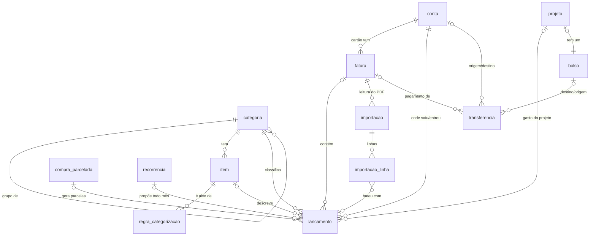

# Modelo de dados — guia de leitura

O que é cada tabela, como elas se ligam e o que é gravado em cada tipo de entrada. Os valores dos exemplos são fictícios.

A versão didática deste guia, com diagramas, analogias e uma aba sobre a arquitetura (Supabase, GitHub, Cloudflare), está no "Caderno do Hub Financeiro": https://claude.ai/artifact/3PnTg3QMAhrb5sLLeUT6pP. Este arquivo continua sendo a referência técnica versionada junto com o código.

Estado em 12/11/2026: 16 tabelas e a view `v_lancamento` (7 migrations). O que está marcado como **(fase 1)** é comportamento do app que ainda será construído; a tabela já está pronta para recebê-lo.

## 1. A ideia em três frases

1. **Tudo que é gasto ou renda é uma linha em `lancamento`.** É a tabela-fato; o realizado do orçamento sai dela.
2. **Dinheiro que só muda de lugar é uma linha em `transferencia`**: aporte, resgate, pagamento de fatura. Não é gasto nem renda, e é dela que sai a taxa de poupança.
3. **As outras tabelas existem para descrever, agrupar ou gerar essas duas.**

## 2. Mapa

## 3. As tabelas, por grupo

### Classificação: o que é o gasto

| Tabela | Uma linha é | Exemplo |
|---|---|---|
| `categoria` | Um grupo (`pai_id` nulo) ou uma categoria dentro de um grupo | Grupo "Custo de Vida" → categoria "Mercado e Alimentação" |
| `item` | O tipo de gasto dentro da categoria, ou uma fonte de renda | "Streamings e Assinaturas" (Lazer); "Empresa A" (Salário Principal) |
| `regra_categorizacao` | Um padrão de texto que leva a um item | `netflix` → item Streamings e Assinaturas |

Colunas que mandam no comportamento:

- `categoria.natureza` (receita ou despesa): é o que diz se um lançamento soma como renda ou como gasto. O valor do lançamento é positivo nos dois casos.
- `categoria.destino` (receita, gasto_do_mes, metas, investimentos): em que bloco do orçamento a categoria aparece.
- `item.nome_norm`: preenchido sozinho pela função `normalizar()` (minúsculas, sem acento, sem "12x - 3", sem "27/12"). "Pão de Açúcar" e "pao de acucar 27/12" viram o mesmo item.
- Categoria → item → observação: o item é o tipo de gasto ("Estacionamento e Pedágio") e o detalhe de cada vez vai na `lancamento.observacao` ("Shopping Centro"). Ao mesclar dois itens pelo app, o nome do que some pode virar observação; `resto_do_nome()` tira o pedaço repetido ("Estacionamento Shopping Centro" em "Estacionamento" deixa "Shopping Centro"). A view `v_observacao` dá as observações mais usadas de cada item, que a tela sugere.
- Até 13/11/2026 havia uma `subcategoria` pendurada no item. As antigas subcategorias viraram os itens de hoje e a tabela saiu do banco.

### Onde o dinheiro está

| Tabela | Uma linha é | Exemplo |
|---|---|---|
| `conta` | Um lugar por onde o dinheiro passa | "Conta" (corrente), "Cartão Principal" (cartão) |
| `fatura` | Um mês de um cartão | Cartão Principal, competência nov/2026, fecha dia 28 |
| `bolso` | Um destino de dinheiro guardado | "Reserva de Emergência", "Carteira Principal", "Casa Nova" |
| `projeto` | Uma meta com alvo e prazo (Projetos Futuros, e a Reserva de Emergência) | "Viagem de férias": alvo, início, fim, % do CDI |

- Todo projeto tem exatamente um bolso. Os bolsos fixos (reserva, carteiras, amortização) não têm projeto.
- `bolso.conta_na_poupanca`: verdadeiro para reserva, carteiras e amortização; falso para projetos. É o que separa patrimônio de consumo adiado.
- `conta` responde "por onde passou"; `bolso` responde "para que serve". Um aporte sai da Conta (conta) e vai para a Reserva (bolso).

### Os fatos

| Tabela | Uma linha é |
|---|---|
| `lancamento` | Um gasto, uma renda ou um estorno |
| `transferencia` | Um aporte, resgate, amortização, pagamento de fatura ou movimento entre contas |

Colunas de `lancamento` que valem explicação:

| Coluna | Significado |
|---|---|
| `data` | Dia real da compra ou do recebimento |
| `competencia` | Mês de orçamento (sempre dia 1). Em conta: o mês da data. Em cartão: o mês em que a fatura fecha |
| `valor` | Positivo para gasto e para renda; negativo é estorno |
| `fatura_id` | Preenchido só em compra no cartão |
| `descricao_original` | O texto como chegou (digitado, do Apple Pay ou do PDF). Nunca é alterado |
| `item_id` | O item normalizado. É por ele que se agrupa |
| `observacao` | Detalhe opcional daquele lançamento ("Shopping Centro", "lanche da viagem"). Não agrupa nem vira item: o item diz *o quê*, a observação diz *qual* |
| `origem_input` | Como a linha nasceu: manual, atalho, recorrente, parcela, fatura_pdf, migracao |
| `status` | `pendente` = está na caixa de entrada esperando revisão; `confirmado` = vale |
| `conciliado` | Já bateu com uma linha da fatura |
| `compra_parcelada_id`, `parcela_numero` | Preenchidos quando a linha é uma parcela |
| `recorrencia_id` | Preenchido quando veio de um modelo recorrente |
| `projeto_id`, `pago_com_projeto` | Gasto ligado a um projeto; se pago com o saldo dele, não conta de novo no mês |
| `chave_dedup` | Impede que a mesma linha entre duas vezes |

### Geradores: produzem lançamentos

| Tabela | Uma linha é | Gera |
|---|---|---|
| `compra_parcelada` | Uma compra em N vezes | N lançamentos, um por fatura |
| `recorrencia` | Um modelo mensal ou anual (condomínio, luz) | Um lançamento pendente por período |

### Conferência de fatura

| Tabela | Uma linha é |
|---|---|
| `importacao` | Uma leitura de fatura (PDF ou texto colado) ou de extrato da conta (OFX), com os totais do resultado |
| `importacao_linha` | Uma linha lida e o que aconteceu com ela: bateu, nova, divergente, ignorada. Aponta para o lançamento ou a transferência com que bateu |

Essas duas são o "rascunho" da conciliação. Nada do orçamento lê delas; servem para mostrar o que bateu e para não reprocessar o mesmo arquivo (`hash_arquivo`).

### Apoio

| Tabela | Uma linha é |
|---|---|
| `cenario` | Ideal, Reduzido, Mínimo, Economia: modelos para preencher o orçamento de um mês |

### Orçamento (fase 2)

| Tabela | Uma linha é |
|---|---|
| `orcamento` | Um valor orçado de um mês **ou** de um cenário, para uma categoria (a linha inteira ou o "Outros gastos" dela), um item ou um bolso |

As linhas do mês são as da aba Resultados. Uma categoria comum é uma linha; "Poupança e Investimentos" e "Metas" são uma linha só cada, e o detalhe delas são os bolsos (reserva, carteiras, amortização, projetos) e as categorias de dentro (Seguro de Vida, Projetos Realizados). O total de uma linha é a soma do que a compõe: valor cheio, ou itens + "Outros gastos".

O grupo **Descontos** (gastos pessoais e PJ) só existe no orçamento: não é lançado, e no realizado vale o orçado.
| `membro` | Quem pode entrar e com que papel (editor ou leitor) |

## 4. O que é gravado em cada tipo de entrada

Legenda: **L** = `lancamento`, **T** = `transferencia`.

### 4.1 Gasto manual no cartão

Você digita R$ 80, Lazer, "Outback", no dia 12/11.

| Tabela | O que acontece |
|---|---|
| `item` | Procura "outback" em Lazer. Existe: usa e soma 1 em `usos`. Não existe: cria |
| `fatura` | Procura a fatura do cartão principal de nov/2026. Não existe: cria como `aberta` |
| **L** | 1 linha: data 12/11, competência nov/2026, valor 80, conta Cartão Principal, a fatura, categoria Lazer, o item, `origem_input = manual`, `status = confirmado`, `conciliado = false` |

Se a compra fosse no dia 29/11, depois do fechamento do dia 28, a competência seria dez/2026 e a fatura a de dezembro.

### 4.2 Gasto manual na conta (Pix, débito, boleto)

Igual ao anterior, sem fatura: `conta = Conta`, `fatura_id` vazio, competência = mês da data.

### 4.3 Renda

Mesma tabela. Categoria de natureza receita (Salário Principal), item = a fonte (Empresa A), conta = Conta. **L**: 1 linha com valor positivo.

### 4.4 Compra parcelada (fase 1)

Você lança R$ 1.200 em 6x, primeira parcela na fatura de nov/2026.

| Tabela | O que acontece |
|---|---|
| `compra_parcelada` | 1 linha: valor total 1.200, 6 parcelas, primeira competência nov/2026 |
| `fatura` | Cria as que faltarem, de nov/2026 a abr/2027 |
| **L** | 6 linhas de R$ 200, competências de nov a abr, `parcela_numero` de 1 a 6, `origem_input = parcela`, todas apontando para a compra |

Editar ou cancelar a compra refaz só as parcelas de faturas ainda abertas. Apagar a compra apaga as parcelas.

### 4.5 Recorrente (fase 1)

Cadastro único em `recorrencia`, criado a partir de um lançamento real: "Condomínio", Moradia, Conta, valor estimado, dia 10. O mês desse lançamento conta como já gerado.

Ao abrir o app no mês seguinte (`gerar_recorrentes`): **L** ganha 1 linha `pendente`, `origem_input = recorrente`, `recorrencia_id` preenchido, com o valor estimado, a observação e o item do modelo. Se o mês já tem um lançamento igual (mesma categoria, item e observação, lançado à mão), nada é criado. `recorrencia.ultimo_mes_gerado` guarda até onde já gerou: apagar o pendente pula o mês.

Você confirma com um toque (`confirmar_lancamento`) ou abre e ajusta o valor. Ao confirmar, `valor_estimado` do modelo passa a ser o valor confirmado: a conta de luz do mês seguinte parte da deste.

### 4.6 Apple Pay pelo atalho (fase 1)

O iPhone envia comerciante "PAO DE ACUCAR 1234" e valor 152,30.

| Etapa | O que acontece |
|---|---|
| Chegada | **L**: 1 linha `pendente`, `origem_input = atalho`, `descricao_original` e `observacao` = o texto do comerciante, conta Cartão Principal, data de hoje |
| Sugestão | `regra_categorizacao` é consultada com o texto normalizado. Achou: preenche `item_id` e `categoria_id`. Não achou: ficam vazios |
| Revisão | Na caixa de entrada você confirma ou corrige. A linha vira `confirmado` |
| Aprendizado | Se você corrigiu, nasce ou muda uma regra (`origem = correcao`), e a próxima compra igual já vem certa |

### 4.7 Investimento, reserva e projeto futuro

Você lança "Investimentos → Reserva de Emergência, R$ 1.000".

**T**: 1 linha, `tipo = aporte`, conta de origem = Conta, `bolso` = Reserva de Emergência. Nenhuma linha em `lancamento`.

| Caso | Diferença |
|---|---|
| Aporte na carteira | `bolso` = Carteira Principal |
| Guardar para a viagem | `bolso` = o bolso do projeto Viagem de férias |
| Resgate | `tipo = resgate`, conta de destino = Conta |
| Amortização extra | `tipo = amortizacao`, `bolso` = Amortização do Apartamento |

Seguro de vida é a exceção do grupo: é **L**, despesa na categoria "Seguro de Vida".

### 4.8 Gasto de um projeto

Você paga R$ 3.000 de passagens.

| Como pagou | O que é gravado |
|---|---|
| Com a renda do mês | **L** em "Projetos Realizados", `projeto_id` = Viagem de férias, `pago_com_projeto = false`. Conta no realizado de Metas |
| Com o saldo guardado | **T** de resgate do bolso do projeto, e **L** em "Projetos Realizados" com `pago_com_projeto = true`. Não conta de novo em Metas, porque já contou quando foi guardado |

### 4.9 Estorno ou reembolso

**L** com valor negativo, na mesma categoria e item do gasto original. Abate o realizado do mês em que cai.

### 4.10 Fechamento da fatura pelo PDF (fase 1)

Você envia o PDF da fatura de nov/2026 com 150 linhas.

| Etapa | O que acontece |
|---|---|
| Leitura | `importacao`: 1 linha. `importacao_linha`: 150 linhas com data, descrição e valor lidos. `fatura.total_pdf` e `data_fechamento` são preenchidos |
| Conciliação | Cada linha lida procura um **L** da mesma fatura com mesmo valor e data próxima |
| Bateu | `importacao_linha.resultado = bateu`, aponta para o **L**, e o **L** recebe `conciliado = true`. Nada novo é criado |
| Não achou | `resultado = nova`. Você confirma e nasce um **L** com `origem_input = fatura_pdf`, já com a sugestão de categoria pela regra. É o caso de compras online e assinaturas |
| Valor diferente | `resultado = divergente`. Você decide qual valor vale |
| Sobrou no app | **L** da fatura que continuou com `conciliado = false`: lançado e não cobrado. Você apaga ou move de mês |
| Fim | Soma dos **L** = `total_pdf` → `fatura.status = conferida` |

### 4.11 Pagamento da fatura

**T**: 1 linha, `tipo = pagamento_fatura`, conta de origem = Conta, `fatura_id` = a fatura. `fatura.status = paga`.

Não é lançamento porque os gastos já foram contados um a um. Se fosse, a fatura contaria em dobro.

### 4.12 Extrato da conta corrente

Correção ao briefing: só a fatura do cartão não é exportável. O extrato da conta sai em OFX, XLSX e PDF. O app lê o **OFX**, que é estruturado e traz um identificador único por movimento (FITID), então não depende de layout nem gera duplicata. (fase 1; schema na migration 6)

Você envia o OFX de nov/2026 com 30 movimentos.

| Etapa | O que acontece |
|---|---|
| Leitura | `importacao`: 1 linha com `tipo = ofx`, `conta_id` = Conta e a competência (sem fatura). `importacao_linha`: 30 linhas, cada uma com o FITID em `id_externo` |
| Saída que é gasto (Pix, boleto, débito) | Procura um **L** da conta com mesmo valor e data próxima. Bateu: marca `conciliado`. Não achou: propõe um **L** novo, com sugestão de categoria |
| Entrada que é renda | O mesmo, com **L** de receita |
| Pagamento da fatura do cartão | Bate com a **T** de `pagamento_fatura`, ou a cria. Nunca vira gasto |
| Aporte ou resgate | Bate com a **T** correspondente, ou propõe uma nova pedindo o bolso |
| Recorrentes | Um **L** pendente de recorrência que bate com o extrato é confirmado com o valor real |

Tudo que nasce do extrato recebe `chave_dedup = 'ofx:' + FITID`: importar o mesmo arquivo de novo, ou um período que se sobrepõe, não duplica nada.

Como a conta tem poucos movimentos, o lançamento manual continua valendo; o OFX serve para confirmar os recorrentes de uma vez e para garantir que nada ficou de fora.

## 5. De onde sai cada número

| Número | Consulta, em palavras |
|---|---|
| Realizado por categoria no mês | Soma de `lancamento.valor` confirmados, por `competencia` e categoria de natureza despesa |
| Realizado por item | O mesmo, agrupando por `item_id` |
| Orçado de uma linha no mês | Soma das linhas de `orcamento` daquele mês que compõem a linha (`resultado_mes`) |
| Realizado de Poupança e Investimentos | Aportes − resgates nos bolsos que contam na poupança + Seguro de Vida |
| Saldo do mês | Ganhos − descontos − (poupança + metas + gastos) |
| Renda do mês | Soma dos lançamentos em categorias de natureza receita |
| Realizado de Metas | Lançamentos de "Projetos Realizados" com `pago_com_projeto = false` + aportes em bolsos de projeto |
| Taxa de poupança | (aportes − resgates em bolsos com `conta_na_poupanca`) ÷ renda |
| Saldo de um projeto | Saldo de partida + aportes − resgates no bolso − gastos pagos com o projeto, tudo corrigido pelo CDI (`projetos_situacao`) |
| Aporte necessário de um projeto | PMT com pagamento no início do mês, do mês atual (ou do início) até o mês final, para chegar em alvo − já gasto |
| Total de uma fatura | Soma dos lançamentos com aquele `fatura_id` |
| Caixa de entrada | Lançamentos com `status = pendente` |

## 6. Regras que o banco garante sozinho

- Competência é sempre dia 1.
- Lançamento confirmado sempre tem categoria; só pendente pode ficar sem.
- Valor de lançamento nunca é zero; valor de transferência é sempre positivo.
- Uma fatura por cartão e mês; um item por categoria e nome normalizado.
- A mesma linha importada não entra duas vezes (`chave_dedup`).
- Quem não é membro não lê nada; leitor não escreve; visitante sem login não acessa tabela nem função.
